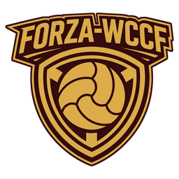

# Forza-WCCF

Community tools to run your own copy of World Club Champion Football on a Windows PC: the 2010–11 and 2017–18
editions. Forza-WCCF sets up the game folder you already have, starts the original programs behind a network guard,
and adds an in-game panel (formation board, card catalogue, keys and controllers, club card), English and Italian game
text, and online play between homes.

The game is not included. You need your own copy of the game files.

## Status

Version 0.x, alpha. The 2017–18 test builds come first. Expect bugs, and keep a backup of your saves.

## Install

1. Download the ZIP for your edition (and the installer, if you want it) from [Releases](../../releases).
2. Unzip it, start `Launcher.exe` and point it at your game folder.
3. The README inside the ZIP explains the rest: [2017–18](editions/2017-18/README.txt),
   [2010–11](editions/2010-11/README.txt).

To report a bug: press SAVE LOGS in the panel and attach the file to a [GitHub issue](../../issues). English, Italian
and Japanese are all welcome.

## Links

- [docs/SELF-HOSTING.md](docs/SELF-HOSTING.md): run your own server.
- [CONTRIBUTING.md](CONTRIBUTING.md): build from source, send a change.
- [docs/SAFETY.md](docs/SAFETY.md): the rules for running the original programs.
- [docs/ROADMAP.md](docs/ROADMAP.md): what is done and what comes next.
- [CREDITS.md](CREDITS.md): who made this, and the earlier projects it comes from.
- [CODE_OF_CONDUCT.md](CODE_OF_CONDUCT.md).

## License

Forza-WCCF's own code is under either of [MIT](LICENSE-MIT) or [Apache-2.0](LICENSE-APACHE), at your option.
Third-party parts keep their own licenses; see [CREDITS.md](CREDITS.md).

## Italiano

Forza-WCCF è un insieme di strumenti della community per giocare alla tua copia di World Club Champion Football
(edizioni 2010–11 e 2017–18) su un PC Windows. Il gioco non è incluso: servono i file della tua copia.

È una versione alpha (0.x): arrivano prima le build di prova della 2017–18, e ci saranno bug. Scarica lo ZIP della tua
edizione da [Releases](../../releases), avvia `Launcher.exe` e scegli la cartella del gioco; il README dentro lo ZIP
spiega il resto. Per segnalare un problema, premi SAVE LOGS nel pannello e allega il file a una
[issue su GitHub](../../issues). Puoi scrivere in italiano.

## 日本語

Forza-WCCF は、お手持ちの World Club Champion Football（2010–11 版と 2017–18 版）を Windows PC で遊ぶための
コミュニティ製ツールです。ゲーム本体は含まれていません。ご自身のゲームファイルが必要です。

現在はアルファ版（0.x）で、2017–18 版のテストビルドから公開します。不具合があることを前提にお使いください。
[Releases](../../releases) からお使いの版の ZIP をダウンロードし、`Launcher.exe` を起動してゲームフォルダーを
選んでください。詳しくは ZIP 内の README を参照してください。不具合は、パネルの SAVE LOGS で保存したファイルを
[GitHub の Issue](../../issues) に添付して報告してください。日本語でも大丈夫です。
